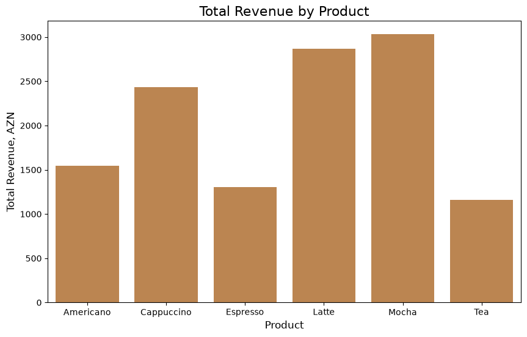
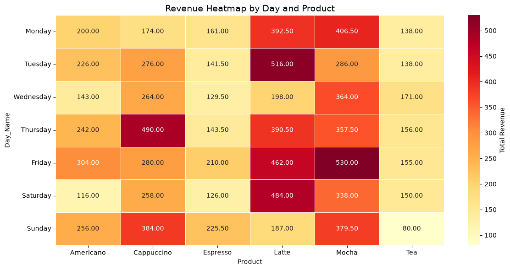

# Coffee Shop Sales — Exploratory Data Analysis

## Project overview
This project uses Python to explore coffee shop sales, product performance, purchasing patterns and revenue drivers, with the aim of identifying actionable business insights.

## Key findings
| Metric | Result |
|---|---:|
| Transaction records | 970 |
| Total revenue | 12,558 AZN |
| Average revenue per record | 12.95 AZN |
| Card payments | 65.77% |
| Highest-revenue product | Mocha (3,030.50 AZN) |
| Highest quantity sold | Latte (512 units) |
| Quantity–revenue correlation | 0.874 |

## Analysis scope
- Data overview and descriptive statistics
- Product performance and payment methods
- Order size and revenue distribution
- Daily sales and weekday/weekend comparisons
- Correlation and multivariate analysis
- Order segmentation and business recommendations

## Visualizations

## Tools
Python, Pandas, Matplotlib, Seaborn and Jupyter Notebook.

## How to run
1. Clone or download this repository.
2. Install dependencies: `pip install -r requirements.txt`.
3. Place an authorized, anonymized copy of `coffee_shop_final.csv` in the repository root. The dataset is not included in this package.
4. Open `coffee_shop_eda.ipynb` in Jupyter and run the cells in order.

Saved notebook outputs can be viewed without the CSV. The notebook has not been re-executed during packaging.

## Business recommendations
- Test bundles and promotions for lower-selling products.
- Maintain convenient card payment options.
- Use observed sales patterns to inform staffing and inventory planning.

## Limitations
- 106 records lack dates and 21 lack product names. Missing dates may bias weekday/weekend comparisons because some undated records are classified as weekdays.
- The number of unique order IDs has not been verified; the reported count is a record count.
- Results are descriptive rather than causal and may not predict future demand.
- Dataset provenance and redistribution permissions should be confirmed before publishing the CSV.
